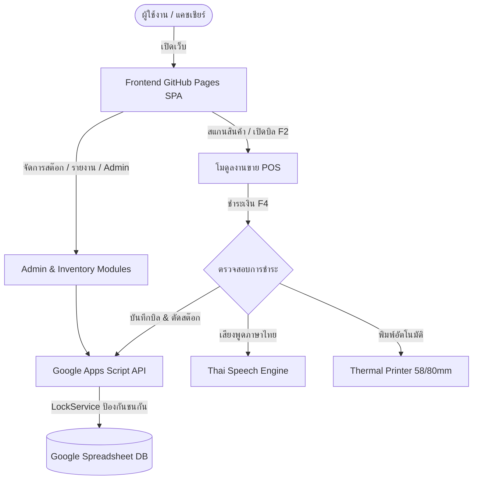

# คู่มือการใช้งานระบบขายสินค้าและสต๊อกสินค้า (POS & Stock Management System)
**เวอร์ชันระบบ:** `1.5.0` | **อัปเดตล่าสุด:** `2026-10-31` | **สถานะ:** `Synchronized with Codebase`

เอกสารคู่มือฉบับนี้ถูกสร้างและตรวจสอบความสอดคล้องกับซอร์สโค้ดของระบบโดยอัตโนมัติ ครอบคลุมการใช้งาน การตั้งค่า การบำรุงรักษา และการแก้ปัญหาสำหรับผู้ใช้งานทุกระดับ (Admin, Manager, Cashier, Stock Keeper)

---

## สารบัญคู่มือ (Table of Contents)
1. [🚀 ภาพรวมและสถาปัตยกรรมระบบ (System Overview)](#overview)
2. [⚙️ การติดตั้งและการเชื่อมต่อครั้งแรก (Initial Setup)](#setup)
3. [🔐 การเข้าสู่ระบบและสิทธิ์การใช้งาน (Login & RBAC)](#login)
4. [🛒 ระบบงานขายหน้าร้าน (POS Sales Screen)](#sales)
5. [⌨️ ตารางคีย์ลัดแป้นพิมพ์แคชเชียร์ (Cashier Shortcuts)](#shortcuts)
6. [🔊 ระบบเสียงพูดแจ้งยอดภาษาไทย (Thai Speech TTS)](#voice)
7. [🖨️ การพิมพ์ใบเสร็จความร้อนและโหมดเงียบ (Thermal Printing)](#printer)
8. [📦 ระบบสต๊อกสินค้า (Inventory Management)](#stock)
9. [📊 รายงานยอดขายและการเงิน (Reports & Finance)](#reports)
10. [🛠️ ระบบผู้ดูแลระบบ (Admin Module)](#admin)
11. [💾 การสำรองและกู้คืนฐานข้อมูล (Backup & Restore)](#backup)
12. [🛡️ ประวัติการใช้งานระบบ (Audit Logs & Security)](#audit)
13. [❓ การแก้ปัญหาที่พบบ่อย (Troubleshooting & FAQs)](#troubleshooting)

---

<a id="overview"></a>
## 🚀 ภาพรวมและสถาปัตยกรรมระบบ (System Overview)

> [!NOTE]
> **หมวดหมู่:** ภาพรวมระบบ | **คำค้นหา:** overview, ภาพรวม, สถาปัตยกรรม, gas, sheets, github pages, โครงสร้าง

### 1. โครงสร้างสถาปัตยกรรมระบบ (3-Tier Serverless Architecture)
ระบบถูกออกแบบด้วยสถาปัตยกรรมที่ทันสมัย ไม่ต้องเช่า Host/Server เสียค่าบริการรายเดือน:
- **Frontend SPA (Single Page Application)**: ทำงานบน **GitHub Pages** ด้วย HTML5, Vanilla JavaScript (ES6 Modules) และ Tailwind CSS โดยไม่ต้อง Build หรือใช้ Node modules ใน Production
- **Backend API Gateway**: ทำงานบน **Google Apps Script (Web App)** สื่อสารผ่าน POST API ป้องกันปัญหา CORS มีระบบ Session Token และ LockService ป้องกัน Race Condition
- **Database**: จัดเก็บข้อมูลบน **Google Spreadsheet** 100% รองรับ 21 ตารางข้อมูลหลัก

### 2. โมดูลหลักที่เปิดใช้งานในระบบ
- `view_login`: หน้าจอ **LOGIN**
- `view_launcher`: หน้าจอ **LAUNCHER**
- `view_sales`: หน้าจอ **SALES**
- `view_stock`: หน้าจอ **STOCK**
- `view_reports`: หน้าจอ **REPORTS**
- `view_finance`: หน้าจอ **FINANCE**
- `view_admin`: หน้าจอ **ADMIN**
- `view_manual`: หน้าจอ **MANUAL**

---

<a id="setup"></a>
## ⚙️ การติดตั้งและการเชื่อมต่อครั้งแรก (Initial Setup)

> [!NOTE]
> **หมวดหมู่:** การติดตั้งและตั้งค่า | **คำค้นหา:** setup, ติดตั้ง, deploy, authorization, config, apps script

### ขั้นตอนการเชื่อมต่อและเปิดใช้งานระบบ

#### ขั้นตอนที่ 1: ให้สิทธิ์ Apps Script (Authorization & Setup)
1. เปิด **Google Apps Script Editor** ที่ผูกกับ Google Sheet ของคุณ
2. ที่เมนูด้านบน เลือกฟังก์ชัน **`setupDatabase`** แล้วกด **เรียกใช้ (Run)**
3. ระบบจะขอสิทธิ์การเข้าถึง Google Sheets ให้กด **ตรวจสอบสิทธิ์ (Review Permissions)** -> **ขั้นสูง (Advanced)** -> **ไปที่ POS Stock Script (ไม่ปลอดภัย)** -> **อนุญาต (Allow)**
4. เมื่อสำเร็จ ตารางทั้งหมด (21 ตาราง) จะถูกสร้างลงในชีตโดยอัตโนมัติ

#### ขั้นตอนที่ 2: Deploy เป็น Web App
1. กดปุ่ม **ทำให้ใช้งานได้ (Deploy)** มุมบนขวา -> เลือก **การทำให้ใช้งานได้รายการใหม่ (New deployment)**
2. ประเภทการติดตั้ง: **เว็บแอป (Web app)**
3. สิทธิ์การเข้าถึง (Who has access): เลือก **ทุกคน (Anyone)** *(สำคัญมาก เพื่อให้ GitHub Pages ยิงเชื่อมต่อได้)*
4. คัดลอก **URL เว็บแอป (Web App URL)** ที่ลงท้ายด้วย `/exec`

#### ขั้นตอนที่ 3: ตั้งค่าในหน้าเว็บ
1. เปิดไฟล์ `frontend/config.js` นำ URL ที่ได้ใส่ในช่อง `API_URL`
2. หรือในหน้า Login ของเว็บ ให้กดปุ่ม **"⚙️ ตั้งค่า API URL"** เพื่อบันทึก URL ตรงลงใน LocalStorage

---

<a id="login"></a>
## 🔐 การเข้าสู่ระบบและสิทธิ์การใช้งาน (Login & RBAC)

> [!NOTE]
> **หมวดหมู่:** ความปลอดภัยและสิทธิ์ | **คำค้นหา:** login, สิทธิ์, บทบาท, roles, rbac, users, password, branch

### ข้อมูลการเข้าสู่ระบบเริ่มต้น
| บัญชี | Username | Password เริ่มต้น | สิทธิ์และหน้าที่ |
|---|---|---|---|
| **ผู้ดูแลระบบ (Admin)** | `admin` | `Admin1234!` | สิทธิ์สูงสุด เข้าถึงได้ทุกระบบ ทุกฟังก์ชัน |
| **ผู้จัดการสาขา (Manager)** | `manager` | `User1234!` | จัดการการขาย ยกเลิกบิล ปรับสต๊อก และดูรายงาน |
| **พนักงานขาย (Cashier)** | `cashier` | `Cashier1234!` | เข้าใช้งานหน้าขาย พิมพ์ใบเสร็จ ดูสต๊อกคงเหลือ |
| **เจ้าหน้าที่สต๊อก (Stock Keeper)** | `stock` | `User1234!` | จัดการสินค้า รับเข้า ปรับสต๊อก โอนย้าย ดูรายงานสต๊อก |

### ระบบการเลือกและสลับสาขา (Multi-Branch Selection)
- ในหน้า Login ผู้ใช้สามารถเลือกสาขาที่กำลังประจำการได้
- หลังจากล็อกอินแล้ว สามารถคลิกที่ชื่อสาขาบน Header ด้านบนขวาเพื่อเปิดหน้าต่างสลับสาขาได้ทันที
- ข้อมูลการขายและสต๊อกจะถูกแยกตามสาขาที่ปฏิบัติงานอัตโนมัติ

---

<a id="sales"></a>
## 🛒 ระบบงานขายหน้าร้าน (POS Sales Screen)

> [!NOTE]
> **หมวดหมู่:** ระบบขาย (POS) | **คำค้นหา:** sales, pos, ขาย, บิล, สแกน, บาร์โค้ด, ส่วนลด, ชำระเงิน, ทอนเงิน

### ฟังก์ชันเด่นในระบบงานขายหน้าร้าน

#### 1. ขายพร้อมกันได้หลายบิลไม่จำกัด (Multi-Bill Tabs)
- กดปุ่ม **`+ บิลใหม่ (F2)`** เพื่อเปิดแท็บบิลลูกค้าคนถัดไปได้ทันที
- สามารถสลับระหว่างแท็บบิลได้อิสระ ข้อมูลสินค้าในแต่ละบิลจะถูกบันทึกลงใน `localStorage` อัตโนมัติ (แม้ปิดเบราว์เซอร์หรือไฟดับ บิลก็ไม่หาย)

#### 2. สแกนบาร์โค้ดและระบบค้นหาอัจฉริยะ (Smart Search & Matcher)
- ช่องค้นหามีระบบ Auto-focus สำหรับเครื่องสแกนบาร์โค้ด สแกนปุ๊บตัดยอดลงบิลทันทีพร้อมเสียง Beep
- **Thai Diacritic Tolerance**: ค้นหาคำไทยได้แม้พิมพ์ตกวรรณยุกต์หรือสระ
- ผลการค้นหาจัดลำดับคะแนนความแม่นยำ (Exact Barcode -> SKU -> ชื่อสินค้า)

#### 3. การรับชำระเงิน (Payment Modal - F4)
- รองรับทั้ง **เงินสด (Cash)** และ **เงินโอน/QR Code (Transfer)**
- มีปุ่มทางลัดใส่จำนวนเงินด่วน (`+20`, `+50`, `+100`, `+500`, `+1000`, `พอดี`)
- คำนวณเงินทอนอัตโนมัติ และป้องกันการรับเงินต่ำกว่ายอดสุทธิ

---

<a id="shortcuts"></a>
## ⌨️ ตารางคีย์ลัดแป้นพิมพ์แคชเชียร์ (Cashier Shortcuts)

> [!NOTE]
> **หมวดหมู่:** คีย์ลัด | **คำค้นหา:** shortcuts, คีย์ลัด, f1, f2, f4, esc, keyboard

### ตารางคีย์ลัดสำหรับพนักงานขาย
| ปุ่มลัด | หน้าจอที่ใช้งาน | ผลการทำงาน |
|---|---|---|
| <kbd>F1</kbd> | **ทั่วทั้งระบบ** | เปิดหน้าคู่มือการใช้งานระบบ (In-App Manual) |
| <kbd>F2</kbd> | **ระบบงานขาย (POS)** | เปิดบิลขายใหม่ (เพิ่มแท็บ Draft บิลถัดไปอัตโนมัติ) |
| <kbd>F4</kbd> | **ระบบงานขาย (POS)** | เปิดหน้าต่างชำระเงิน (Payment Modal) |
| <kbd>Esc</kbd> | **ทุกหน้าต่างโมดอล & คู่มือ** | ปิดหน้าต่างป๊อปอัป / ปิดคู่มือย้อนกลับสู่ระบบ |
| <kbd>Enter</kbd> | **ช่องค้นหา & ชำระเงิน** | ค้นหาสินค้าลงตะกร้าทันที / ยืนยันชำระเงิน |
| <kbd>ลูกศรขึ้น / ลง</kbd> | **ช่องค้นหาสินค้า** | เลื่อนเลือกรายการสินค้าจากแถบผลการค้นหาอัจฉริยะ |

> [!TIP]
> สำหรับหน้าจอสัมผัส (Touchscreen) ระบบมีปุ่มขนาดใหญ่ที่สามารถแตะใช้งานได้สะดวกโดยไม่ต้องใช้คีย์บอร์ด

---

<a id="voice"></a>
## 🔊 ระบบเสียงพูดแจ้งยอดภาษาไทย (Thai Speech TTS)

> [!NOTE]
> **หมวดหมู่:** ระบบเสียง | **คำค้นหา:** voice, sound, เสียง, แจ้งยอด, tts, เสียงพูด, ค่ะ, ครับ

### การทำงานของระบบเสียง
ระบบเสียงพูดถูกถอดแบบสถาปัตยกรรมเสียงภาษาไทยจากโปรเจกต์ `clangu89/face-recognition`:
- **เสียงพูดตามลำดับการขาย**:
  1. เมื่อเปิดหน้าชำระเงิน: พูดแจ้งยอดรวม เช่น *"ยอดรวม หนึ่งร้อยห้าสิบบาทถ้วนค่ะ"*
  2. เมื่อกรอกเงินรับ: พูดแจ้งยอดรับเงิน เช่น *"รับเงิน สองร้อยบาทถ้วนค่ะ"*
  3. เมื่อบันทึกสำเร็จ: พูดเงินทอน เช่น *"เงินทอน ห้าสิบบาทถ้วนค่ะ ขอบคุณค่ะ"*
- **การปรับแต่งเสียงในหน้า Admin**:
  - เลือกโทนเสียงพรีเซ็ต (เช่น หญิงสุภาพ, หญิงประชาสัมพันธ์, ชายสุภาพ)
  - เลือกลงท้าย **"ค่ะ"** หรือ **"ครับ"**
  - มีปุ่มเปิด/ปิดเสียงด่วนที่แถบ Header ด้านบนสุด

---

<a id="printer"></a>
## 🖨️ การพิมพ์ใบเสร็จความร้อนและโหมดเงียบ (Thermal Printing)

> [!NOTE]
> **หมวดหมู่:** การพิมพ์ใบเสร็จ | **คำค้นหา:** printer, print, ใบเสร็จ, ความร้อน, 58mm, 80mm, kiosk, เงียบ

### การตั้งค่าการพิมพ์ใบเสร็จ

#### 1. รูปแบบใบเสร็จ
- รองรับกระดาษม้วนความร้อนขนาด **58 มม.** และ **80 มม.**
- ความยาวใบเสร็จยืดหยุ่นตามจำนวนรายการสินค้าจริง ไม่เปลืองกระดาษ
- สามารถปรับแต่ง โลโก้, ชื่อร้าน, ที่อยู่, เลขประจำตัวผู้เสียภาษี, ข้อความหัว-ท้ายบิลได้ในเมนู Admin

#### 2. การเปิดโหมดพิมพ์อัตโนมัติแบบเงียบ (Silent Kiosk Printing)
เพื่อให้พิมพ์ใบเสร็จออกทันทีเมื่อกดขายโดยไม่ต้องขึ้นหน้าต่าง Print Dialog ให้ปฏิบัติดังนี้:
1. ตั้งค่าเครื่องพิมพ์ใบเสร็จให้เป็น **Default Printer** ใน Windows
2. รันสคริปต์ **`start-pos-kiosk.bat`** ในโฟลเดอร์ของโปรเจกต์
3. เบราว์เซอร์ Google Chrome จะเปิดขึ้นมาพร้อมแฟล็ก `--kiosk-printing` ใบเสร็จจะวิ่งตรงสู่เครื่องพิมพ์ทันที

---

<a id="stock"></a>
## 📦 ระบบสต๊อกสินค้า (Inventory Management)

> [!NOTE]
> **หมวดหมู่:** ระบบสต๊อก | **คำค้นหา:** stock, สต๊อก, สินค้า, รับเข้า, ปรับยอด, โอนย้าย, stock card

### ฟังก์ชันในระบบสต๊อกสินค้า

1. **แคตตาล็อกสินค้า (Product Catalog)**:
   - จัดการข้อมูลสินค้า บาร์โค้ด SKU หมวดหมู่ หน่วยนับ ราคาทุน และราคาขาย
   - ตั้งค่าระดับแจ้งเตือนสต๊อกใกล้หมด (Min Stock Alert)
2. **รับสินค้าเข้าคลัง (Stock In)**:
   - บันทึกเอกสารรับสินค้าเข้าจากผู้จำหน่าย อัปเดตราคาทุนเฉลี่ย และเพิ่มยอดคงคลังทันที
3. **ตรวจนับและปรับปรุงยอด (Adjust Stock)**:
   - กรอกจำนวนที่นับได้จริง ระบบจะคำนวณยอดดิฟ (+ / -) และบันทึกประวัติการปรับยอดพร้อมเหตุผล
4. **โอนย้ายระหว่างสาขา (Transfer Stock)**:
   - ตัดยอดจากสาขาต้นทางและเพิ่มยอดที่สาขาปลายทางใน Transaction เดียวกัน ป้องกันสต๊อกตกหล่น
5. **บัตรสต๊อกสินค้า (Stock Card)**:
   - ตรวจสอบประวัติความเคลื่อนไหว (Ledger) ของสินค้าแต่ละรายการ แสดงยอดก่อน-หลังและเอกสารอ้างอิง

---

<a id="reports"></a>
## 📊 รายงานยอดขายและการเงิน (Reports & Finance)

> [!NOTE]
> **หมวดหมู่:** รายงานและการเงิน | **คำค้นหา:** reports, รายงาน, ยอดขาย, กำไร, สินค้าขายดี, reprint, พิมพ์ซ้ำ

### ข้อมูลรายงานและการวิเคราะห์

1. **สรุปยอดขายประจำวัน (Daily Sales Summary)**:
   - ยอดขายรวม ต้นทุนรวม กำไรขั้นต้น และยอดแยกตามช่องทางชำระ (เงินสด / เงินโอน)
2. **จัดอันดับสินค้าขายดี (Top Best Sellers)**:
   - แสดงรายการสินค้าที่มียอดขายสูงสุดทั้งตามจำนวนชิ้นและตามมูลค่ายอดเงิน
3. **ประวัติใบเสร็จและการพิมพ์ซ้ำ (Receipt History & Reprint)**:
   - ค้นหาใบเสร็จย้อนหลังตามเลขที่ใบเสร็จ วันที่ หรือชื่อพนักงาน
   - กดดูตัวอย่างใบเสร็จ (Preview Modal) และสั่งพิมพ์ซ้ำได้ทันที
   - การยกเลิกใบเสร็จ (Void) จะมีเครื่องหมาย VOID ปรากฏ และคืนสต๊อกเข้าคลังอัตโนมัติ

---

<a id="admin"></a>
## 🛠️ ระบบผู้ดูแลระบบ (Admin Module)

> [!NOTE]
> **หมวดหมู่:** ผู้ดูแลระบบ | **คำค้นหา:** admin, ผู้ดูแล, users, roles, receipt text, config, format

### การตั้งค่าขั้นสูงในหน้าผู้ดูแลระบบ

- **จัดการผู้ใช้งานและบทบาท**: เพิ่ม ลบ ระงับการใช้งาน แก้ไขรหัสผ่าน และกำหนดสิทธิ์แบบ Matrix
- **จัดการสาขา**: เพิ่มสาขา กำหนดรหัสสาขา และเปิด/ปิดการใช้งานสาขา
- **รูปแบบเลขที่ใบเสร็จ (Receipt Number Format)**:
  - ใช้ Token ยืดหยุ่น เช่น `{PREFIX}{BRANCH}-{YYYY}{MM}{DD}-{RUN:5}`
  - เลือกรอบการรีเซ็ตเลขรันนิ่ง (รายวัน, รายเดือน, รายปี หรือไม่รีเซ็ต)
- **ข้อมูลหัว-ท้ายใบเสร็จ (Receipt Texts)**: กำหนดข้อความเฉพาะสาขา หรือใช้ค่ากลางของสำนักงานใหญ่

---

<a id="backup"></a>
## 💾 การสำรองและกู้คืนฐานข้อมูล (Backup & Restore)

> [!NOTE]
> **หมวดหมู่:** สำรองและกู้คืน | **คำค้นหา:** backup, restore, สำรอง, กู้คืน, sha256, checksum, lockout

### ความปลอดภัยในการสำรองและกู้คืนข้อมูล

1. **การสำรองข้อมูล (Export Backup)**:
   - ส่งออกข้อมูลทุกตารางเป็นไฟล์ `.json` ขนาดกะทัดรัด
   - มีการคำนวณ **SHA-256 Checksum** ประทับลงในไฟล์ เพื่อรับประกันว่าไฟล์ไม่ถูกดัดแปลงหรือเสียหาย
   - รองรับการเลือกสำรองเฉพาะตารางที่ต้องการ (Selective Table Export)
2. **การกู้คืนข้อมูล (Restore Backup)**:
   - มีระบบตรวจสอบ Checksum อัตโนมัติก่อนเขียนข้อมูลลงชีต
   - **Admin Lockout Guard**: ระบบจะปฏิเสธการกู้คืนทันทีหากไฟล์สำรองไม่มีผู้ใช้ Admin ที่ใช้งานได้ ป้องกันการล็อกตัวเองออกจากระบบ
   - มีระบบรักษาสถานะ Session ของ Admin ปัจจุบัน ทำให้ไม่ต้องล็อกอินใหม่หลังการ Restore

---

<a id="audit"></a>
## 🛡️ ประวัติการใช้งานระบบ (Audit Logs & Security)

> [!NOTE]
> **หมวดหมู่:** ความปลอดภัยและประวัติ | **คำค้นหา:** audit, logs, ประวัติ, ความปลอดภัย, session, hash, salt

### บันทึก Audit Log และการรักษาความปลอดภัย
- บันทึกทุกกิจกรรมสำคัญ: การเข้าสู่ระบบ, การขาย, การยกเลิกบิล, การปรับปรุงสต๊อก, การเปลี่ยนรหัสผ่าน, และการ Backup/Restore
- ระบุชื่อผู้ใช้งาน วันเวลา เลขไอพี และสาขาที่ดำเนินการ
- รหัสผ่านของผู้ใช้งานทั้งหมดถูกเข้ารหัสด้วย **SHA-256 ผสม Salt เฉพาะบุคคล** ไม่มีการเก็บรหัสผ่านเป็นข้อความธรรมดา (Plain text)

---

<a id="troubleshooting"></a>
## ❓ การแก้ปัญหาที่พบบ่อย (Troubleshooting & FAQs)

> [!NOTE]
> **หมวดหมู่:** การแก้ปัญหา | **คำค้นหา:** troubleshooting, faq, ปัญหา, cors, error, เครื่องพิมพ์, สิทธิ์หลุด

### ปัญหาที่พบบ่อยและวิธีแก้ไข

#### 1. เข้าสู่ระบบแล้วขึ้นแจ้งเตือนการเชื่อมต่อผิดพลาด หรือ CORS Error
- **สาเหตุ**: การตั้งค่าสิทธิ์ Deploy ของ Web App ไม่ได้ตั้งค่าเป็น "ทุกคน (Anyone)"
- **วิธีแก้**: ใน Apps Script Editor ให้กด Deploy -> จัดการการทำให้ใช้งานได้ -> แก้ไข -> เปลี่ยน "ผู้มีสิทธิ์เข้าถึง" เป็น **"ทุกคน (Anyone)"** แล้วบันทึก

#### 2. สแกนบาร์โค้ดแล้วตัวเลขไม่ลงช่องค้นหา
- **สาเหตุ**: หน้าจอไม่ได้เลือกโฟกัสอยู่ที่ช่องค้นหา หรือคีย์บอร์ดของเครื่องสแกนตั้งภาษาไทยค้างไว้
- **วิธีแก้**: กดคลิกที่ช่องค้นหา หรือกดปุ่ม `F2` เพื่อเปิดบิลใหม่ซึ่งจะโฟกัสช่องค้นหาให้อัตโนมัติ และตรวจสอบให้เครื่องสแกนส่งรหัสเป็นภาษาอังกฤษ/ตัวเลข

#### 3. ใบเสร็จไม่ออกเครื่องพิมพ์ หรือมีหน้าต่าง Print Preview เด้งขึ้นมา
- **สาเหตุ**: ยังไม่ได้เปิดเบราว์เซอร์ผ่านโหมด Kiosk Printing
- **วิธีแก้**: ปิด Google Chrome ทั้งหมด แล้วดับเบิลคลิกไฟล์ `start-pos-kiosk.bat` เพื่อเปิดเบราว์เซอร์พร้อมพิมพ์อัตโนมัติ

---

## ผังการทำงานภาพรวมของระบบ (System Workflow Architecture)



---

## การอัปเดตคู่มืออัตโนมัติ (Automated Documentation Pipeline)
เมื่อมีการเพิ่มฟีเจอร์ เปลี่ยนแปลงคีย์ลัด หรือปรับโครงสร้างสิทธิ์ ให้รันคำสั่ง:
```bash
npm run manual:update
```
หรือตรวจสอบความสอดคล้องผ่าน CI:
```bash
npm run manual:verify
```
